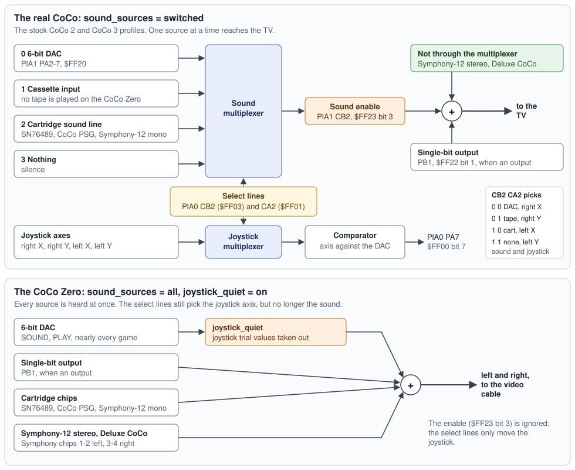

# Sound chips

What the CoCo Zero can play, where each sound source sits in the memory map, how
to turn it on and off, and how it is built. The signal path from the mixed sample
to the video cable is in [`pipeline.md`](pipeline.md); this page stops at the
mixed sample.

## At a glance

| Source | Voices | Addresses | Setting | `cocozero` | `coco2` | `coco3` |
|---|---|---|---|---|---|---|
| The CoCo's 6-bit DAC | 1 | `$FF20` bits 2-7 | always on | on | on | on |
| Single-bit output | 1 | `$FF22` bit 1 | always on | on | on | on |
| SN76489 (Games Master Cartridge) | 3 tones + noise | `$FF41` | `sn76489` | on | off* | off* |
| AY-3-8910 (CoCo PSG) | 3 tones + noise | `$FF5D`-`$FF5F` | `coco_psg` | on | off | off |
| 4 x AY-3-8910 (Symphony-12) | 12 tones + 4 noise | `$FF60`-`$FF63` | `symphony12` | on | off | off |
| AY-3-8913 (Deluxe CoCo) | 3 tones + noise | `$FF38`-`$FF39` | `deluxe_psg` | off | off | off |

\* Loading a Games Master Cartridge image (a bank-switched `.ccc`, 32 KB to
256 KB) brings its SN76489 on any machine, whatever the setting says.

Everything can play at once: on the CoCo Zero that is the DAC, three SN76489
tones and its noise, and twelve AY tones, sixteen voices plus the DAC.
[`ay-checks/allvoice.bas`](ay-checks/allvoice.bas) does exactly that.

How they reach the speaker, together or picked by the CoCo's multiplexer, is
the `sound_sources` setting (below): `all` on the CoCo Zero, `switched`, as
the real machine, on the stock CoCo 2 and CoCo 3.

The settings are lines in `/coco/settings.txt`, or in a game's own file beside it
(`STARCAST.TXT` for `STARCAST.DSK`); see [`../SETTINGS.md`](../SETTINGS.md). The
machine profile sets the defaults above, and a line in either file overrides them.

## The CoCo's own sound

The 6-bit DAC is PIA1 port A bits 2-7 (`$FF20`): BASIC's `SOUND` and `PLAY` and
nearly every game use it. The level is picked up the moment the CPU writes the
port and averaged over each output sample, so edges land in the right place
and high tones do not alias.

## The sound multiplexer



### On the real CoCo

Only one sound source at a time reaches the TV. A multiplexer chip picks it,
and a sound enable turns its output on and off:

- **The select lines** are PIA0's two control lines, CA2 (`$FF01` bit 3) and
  CB2 (`$FF03` bit 3). Read as a number, CB2 then CA2, they pick source 0
  the DAC, 1 the cassette input, 2 the cartridge's sound line, or 3 nothing.
- **The sound enable** is PIA1 CB2 (`$FF23` bit 3). Off, the multiplexer's
  output is cut.
- **The single-bit output** is PIA1 port B bit 1 (`$FF22`). It counts only
  while its direction bit makes it an output. Then it adds to the line and
  changes how loud the selected source is; with the enable off it drives
  the line on its own.
- With nothing driving it, the line holds its last level, so turning the
  enable off is silent rather than a click.

The multiplexer chip has a second half that switches the same way, on the
same two select lines: it picks the joystick axis that the comparator
weighs against the DAC. So the select lines always choose a sound source and
a joystick axis together:

| CB2 | CA2 | Sound source | Joystick axis (`JOYSTK`) |
|---|---|---|---|
| 0 | 0 | the DAC | right X (0) |
| 0 | 1 | the cassette input | right Y (1) |
| 1 | 0 | the cartridge's sound line | left X (2) |
| 1 | 1 | nothing | left Y (3) |

That is why reading a joystick changes what is heard. A program reading the
right joystick's X axis with the sound on hears its own trial values (the
buzz in Double Back); reading the left X axis puts the cartridge's sound on
the line for a moment.

The levels, in millivolts, are XRoar's measurements of a real Dragon, whose
sound section is the CoCo's. Each source's level is its input times a gain,
plus an offset, and both depend on the single-bit output:

| Source | PB1 an input | PB1 an output, low | PB1 an output, high |
|---|---|---|---|
| DAC (0-63) | 4,500 x DAC/63 + 200 | 2,840 x DAC/63 + 180 | 3,400 x DAC/63 + 1,300 |
| Cassette | 2,050 | 1,600 | 2,350 |
| Cartridge line | its sound x 1.0 | its sound x 0.60 + 180 | its sound x 0.72 + 1,300 |
| Nothing | 0 | 0 | 0 |
| Enable off | holds | 0 | 3,900 |

The cassette input carries nothing here (no tape is played), so it gives only
its offset. Only changes are heard: the DC blocker after the mix takes out
any steady offset.

**What Color BASIC does with it**, checked in the ROMs:

- At start-up it leaves PB1 an input and the sound enable off.
- `SOUND` (`$A951`) and `PLAY` (`$9A2C` in Extended BASIC) select the DAC and
  turn the enable on before they play.
- `JOYSTK` turns the enable off (`$A974`) before it reads, so BASIC's own
  joystick reads are silent on a real CoCo.
- `CSAVE` never turns the enable on, so its tones go out to the cassette
  without reaching the TV.

**What a sound cartridge game has to do** is select the cartridge line and
turn the enable on, because otherwise its chip is not heard. A Games Master
or CoCo PSG game does this itself. From BASIC, keeping the other bits of each
control register as they are:

```basic
10 POKE &HFF01,PEEK(&HFF01) AND &HF7
20 POKE &HFF03,PEEK(&HFF03) OR 8
30 POKE &HFF23,PEEK(&HFF23) OR 8
```

Line 10 sets CA2 low, line 20 sets CB2 high (together, source 2), and line 30
turns the sound on. The next `SOUND` or `PLAY` selects the DAC again.

Under `sound_sources = switched` (the stock `coco2` and `coco3` profiles),
the board does all of this as the real machine does. These come through the
cartridge line, so the multiplexer decides whether they are heard:

- the SN76489;
- the CoCo PSG;
- the Symphony-12 in mono.

Two are never switched off by the multiplexer:

- the Symphony-12 in stereo, which plays from the card's own jacks (as if
  they were plugged into the speakers);
- the Deluxe CoCo's chip, which is inside that machine.

### On the CoCo Zero

Under `sound_sources = all` (the `cocozero` default) every source is heard at
once:

- **Heard together:** the DAC, the single-bit output, and every sound
  cartridge, in mono or in stereo.
- **The select lines** still pick the joystick axis for the comparator, so
  joysticks read exactly as before, but they no longer choose the sound.
- **The sound enable** is ignored.
- **The single-bit output** still shapes the DAC as the table above shows.

This lets a program do what the real machine could not: play `SOUND` or
`PLAY` over Games Master or Symphony-12 music, or mix the DAC with a sound
cartridge, without choosing between them. A cartridge game that forgets to
select the cartridge line is heard anyway.

**What `all` gives up:** anything a program writes to the DAC while a real
CoCo would have the sound off is heard here:

- `CSAVE`'s tones;
- a game's joystick reads (`joystick_quiet`, below, takes those out again).

A game that relies on the multiplexer to keep something quiet can have the
real behaviour back with `sound_sources = switched` in its own file.

| `sound_sources` | What is heard | Default on |
|---|---|---|
| `switched` | As the real CoCo: the source the multiplexer picks, while the enable is on, and the single-bit output. | `coco2`, `coco3` |
| `all` | Everything at once, whatever the multiplexer and the enable say. | `cocozero` |

## Joystick reads: `joystick_quiet`

A program reads an analog joystick by writing trial values to the DAC and
testing the comparator (PIA0 PA7) after each, six or so per axis. With the
sound on, those trial values are heard as a buzz or a whine whenever the
joystick is read: Double Back does this, and so does a real CoCo running it.
Color BASIC's `JOYSTK` turns the sound off first, so on a real CoCo it is
quiet; under `sound_sources = all` the DAC is always heard, so it would not be.

With `joystick_quiet = on` (the default on `cocozero`), a DAC write that is
followed within 16 CPU cycles by a read of PIA0 port A is taken to be a
trial, and its sound is taken back from the moment of the write, as if it
had never been heard. The comparator still sees the value written, so the
joystick reads exactly as before. To make that possible the sound is held
back one sample (about 21 microseconds). Color BASIC's own `SOUND`, `PLAY`
and cassette routines never read PIA0 right after a DAC write, so they are
not touched; the serial log's `[snd] joystick_probes=N` counts the trials
taken out. A program that wrote the DAC and then read the keyboard within 16
cycles, every time, would lose that sound: if one turns up, give it
`joystick_quiet = off` in its own file.

`joystick_quiet = off` (the default on the stock `coco2` and `coco3`) leaves
every DAC write heard, as on the real machine.

## SN76489: the Games Master Cartridge

John Linville's Games Master Cartridge (GMC) carries a TI SN76489: three square
tone channels and a noise channel, 2 dB attenuation steps, at a 4 MHz clock.

- **Writing it.** One port, `$FF41`. A byte with bit 7 set picks a register and
  sets its low four bits: `1 c c t d d d d`, where `cc` is the channel (3 is the
  noise) and `t` is 1 for the volume. A following byte with bit 7 clear sets a
  tone's upper six bits. A write less than 32 chip clocks after the last is
  ignored, as on the real chip; BASIC is far too slow to hit that.
- **Pitch.** f = 125,000 / N for a 10-bit N (0 means 1024).
- **Volume.** An attenuation of 0 is loudest and 15 is off. The chip starts silent.
- **Noise.** Write `$E0` + mode to the noise register: bit 2 picks white (1) or
  periodic noise, and bits 0-1 the rate (0-2 fixed, 3 follows tone channel 3).
- **Where it lives.** `$FF41` is in the disk controller's latch area, but Disk
  BASIC and OS-9 write the latch only at `$FF40`. The odd mirrors go to the chip
  instead, so the chip and the disk controller work side by side. Set
  `sn76489 = off` to give those addresses back to the controller entirely.
- **Banked images.** A GMC game over 16 KB also switches 16 KB banks through even
  addresses in `$FF40`-`$FF5F`. That works on every machine, and so does its chip.

From BASIC, tone channel 0 at about middle C, at full volume:

```basic
10 N=478:POKE &HFF41,128+(N AND 15):POKE &HFF41,INT(N/16)
20 POKE &HFF41,144
```

## AY-3-8910: three cartridges, one bank of chips

General Instrument's AY-3-8910 (and Yamaha's YM2149) has three tone channels,
one noise generator, a 16-level volume per channel and a hardware envelope. The
board has one bank of four of them, shared by three cartridge front-ends. Each
front-end sets its chips' clock when a program uses it, so the pitch is right for
whichever card the program was written for.

| Cartridge | Chips | Ports | Clock |
|---|---|---|---|
| CoCo PSG | chip 1 | `$FF5E` register select, `$FF5F` data (read and write), `$FF5D` bit 0 picks the clock | 2 MHz (bit 0 = 0) or 1 MHz (bit 0 = 1) |
| Speech Systems Symphony-12 | chips 1-4 | a 6821 PIA at `$FF60`-`$FF63`: port A is the chips' data, port B two bits a chip | 894,886 Hz (14.31818 MHz / 16) |
| Tandy's Deluxe CoCo (unreleased, 1984) | chip 1 | `$FF38` data write, `$FF39` register latch on a write and data on a read | 1.79 MHz (14.31818 MHz / 8) |

- **Registers**, as the data sheet: R0-R5 tone periods (12 bits, f = clock / (16
  x TP)), R6 noise period, R7 the mixer (bits 0-2 tone off, bits 3-5 noise off,
  active high), R8-R10 the levels (bit 4 hands a channel to the envelope),
  R11-R12 the envelope period, R13 its shape (writing it restarts it). The I/O
  ports R14 and R15 read `$FF`.
- **A channel with both tone and noise off is steadily on** at its level, which
  is how AY sample playback works. This follows the data sheet. XRoar makes such
  a channel silent instead.
- **Symphony-12 port B.** Bits 1-0 drive chip 1 and bits 7-6 chip 4: `11`
  latches a register from port A, `10` writes port A to it, `01` reads it onto
  port A. Each bit counts only where port B's direction register makes it an
  output, as on the real PIA. The sequence the card's drivers use, register
  first, then value:

  ```basic
  100 POKE &HFF60,R:POKE &HFF62,3*M(K):POKE &HFF62,0
  110 POKE &HFF60,V:POKE &HFF62,2*M(K):POKE &HFF62,0:RETURN
  ```

  with `M(K)` = 1, 4, 16, 64 for chips 1-4, after making both ports outputs
  (`POKE &HFF61,0:POKE &HFF60,255:POKE &HFF61,4`, and the same for `$FF63` and
  `$FF62`).
- **Where they live.** On the CoCo 2, `$FF38` and `$FF39` repeat the keyboard and
  sound PIA, so turning `deluxe_psg` on there could break a program that uses the
  repeat. That is why it is off on every machine; nearly no software uses it. On
  the CoCo 3 those addresses are free. `$FF5D`-`$FF63` are free on both machines.
- **Shared chip.** All three front-ends use chip 1. A program that drives two
  cartridges at once shares that chip, as it would if the cards really shared it.
- Not emulated: the CoCo PSG's flash memory, RAM and joystick ports, and the AY
  I/O ports.

### Symphony-12 stereo

The real card has a jumper for mono or stereo. With `symphony12_stereo = on` (the
default, on every machine, since it is the card's jumper and not the machine's),
chips 1 and 2 play on the left and chips 3 and 4 on the right, as MAME routes
them. With it off all four are in the middle. A chip that the CoCo PSG or Deluxe
CoCo wrote last stays in the middle either way, so a CoCo PSG game is not stuck
on one side. The DAC and the SN76489 are always in the middle.

## How loud each source is

All sources add into one sample per side, then go through the DC blocker and
the `audio_lowpass` filter, then a clamp to 16 bits. At the default volume of 10:

| Source | Full scale |
|---|---|
| DAC | ±11,520 (360 a step around the middle) |
| SN76489 | 5,670 a channel, 22,680 for all four |
| AY | 7,560 a channel, 22,680 for one chip's three |

Several AY chips on one side are mixed as sum x 2 / (n + 1), so four alike are
1.6 times one rather than four times; a chip with all three levels at 0 is not
counted. In stereo each side is mixed by the chips on that side. The `volume`
setting scales everything (0-15, 10 is the reference). Above 10, or with the DAC
on top of loud chip music, peaks can clip.

## Test programs

All in [`ay-checks/`](ay-checks/), each saved on the card's `AYTEST.DSK`:

| File | Disk name | What it plays |
|---|---|---|
| [`psg.bas`](ay-checks/psg.bas) | `PSG` | CoCo PSG: a chord, then the envelope, then noise |
| [`sym12.bas`](ay-checks/sym12.bas) | `SYM12` | Symphony-12: each chip adds one note of a C major chord |
| [`sym12all.bas`](ay-checks/sym12all.bas) | `SYM12ALL` | Symphony-12: all twelve voices |
| [`stereo.bas`](ay-checks/stereo.bas) | `STEREO` | Symphony-12 stereo: chip 1 left and chip 4 right in turn, then both |
| [`allvoice.bas`](ay-checks/allvoice.bas) | `ALLVOICE` | everything: twelve AY voices, the SN76489's tones and noise drum, AY envelopes, then the DAC on top |

Lines starting with `'` are comments for the reader and are not typed in.

## How it is built

| Part | File : symbol |
|---|---|
| SN76489 chip | `lib/coco_machine/src/csg_sn76489.h` : `sn_write`, `sn_render` |
| GMC banking, `$FF41` decode | `lib/coco_machine/src/cart_gmc.h` : `csg_on_latch_mirror` |
| AY chip | `lib/coco_machine/src/psg_ay8910.h` : `ay_write`, `ay_render` |
| AY bank and front-ends | `lib/coco_machine/src/psg_ay8910.h` : `struct ay_bank`, `ayb_owns`, `ayb_write`, `ayb_read`, `ayb_render_lr` |
| Bus hookup | `lib/coco_machine/src/coco_machine.cpp` : `csg_bus_write`; `ayb_owns` in the CoCo 2 read and write paths and in `coco3_cpu_cycle` |
| The multiplexer, enable, single-bit, joystick trials | `lib/coco_machine/src/coco_sound.h` : `snd_line_mv`, `snd_probe_write`, `snd_probe_read`; in the machine `audio_update_level`, `audio_pia1_written`, `audio_comparator_read` |
| Mixing, filters, stereo ring | `lib/coco_machine/src/coco_machine.cpp` : `audio_sample`, `audio_emit`, `coco_machine_audio_read_lr` |
| Settings | `src/settings.h` : `settings_profile`; applied in `src/main.cpp` : `settings_apply` |

Both chip models are plain integer C, tested on the host (`pio test -e native -f
test_csg_sn76489 -f test_psg_ay8910 -f test_cart_gmc -f test_coco_sound`).
`test_coco_sound` checks the multiplexer's levels and runs a program that
plays a tone while reading the joystick through the audio integrator: with
`joystick_quiet` the samples are those of the tone alone. Each chip is rendered once
per 48 kHz output sample, averaging its output over the sample's time, which keeps
tones above the sample rate from aliasing.

**Rendering only what can change (PIZERO-248).** Stepping every part of every
chip at its own clock cost about 400 CPU clocks a chip a sample on the board, and
`allvoice.bas` overran the frame. Now:

- an AY chip runs only its **heard parts**: a tone switched on in the mixer of a
  channel with a level above 0, the noise if such a channel takes it, the
  envelope if a channel is under it and it is still moving. A part nobody hears
  is left behind and caught up exactly, in one go, when a register write might
  make it heard (`ay_sync`);
- the ticks in which no heard part changes are taken at once (`ay_advance`),
  and a chip keeps its output while nothing heard changes, so most samples only
  count down (`valid`, `quiet`, `pending` in `struct ay8910`);
- the SN76489 takes the ticks in which no counter runs out at once
  (`sn_quiet_ticks`); it does not yet leave silent parts behind (PIZERO-252);
- the render path and its level tables are in RAM, not flash (`SOUND_HOT`,
  `SOUND_TABLE`), and every divide is 32-bit, since a 64-bit divide is a library
  call on the RP2350.

`test_render_skipping_matches_every_tick` (in both chip tests) checks this against
stepping every part every tick, under random register writes between samples of
random length: every sample must match, and the chip's state must match once
caught up.

Measured on the board (product build, CoCo Zero), as emulation time per 16.7 ms
frame:

| | Before PIZERO-248 | Now |
|---|---|---|
| Four Symphony-12 chips (`sym12.bas`), on top of idle | about 5-6 ms | about 1.6 ms (profiler: 1.46 M to 0.64 M clocks a frame of audio work, idle 0.26 M) |
| Everything (`allvoice.bas`) | 15.4-16.7 ms, underruns | 9.3-9.7 ms, peak 10.8 ms, no underruns |

The 1.6 ms includes stereo's second filter chain, which runs while the two sides
differ. Idle at the BASIC prompt is about 6.9 ms. Once a program has used the
SN76489 it costs about 0.85 ms a frame even when silent, until PIZERO-252.

**Telemetry.** The serial log prints `[csg] writes=N dropped=N` once the SN76489
has been written (dropped writes came inside its ready gap) and `[ay] writes=N
chips=M`, where `M` is a bit per AY chip written since reset. The `[settings]`
line shows `sn76489`, `coco_psg`, `symphony12` (`stereo`, `mono` or `off`) and
`deluxe_psg`.

## Not yet

- **Tandy Speech/Sound Cartridge** (PIZERO-249): its AY-3-8913 sits behind a
  microcontroller at `$FF7D`-`$FF7E`, with a speech chip beside it.
- **Real AY software** (PIZERO-251): Lyra 1.2 with the Symphony 12 Enhancer, and
  the Sierra games' PSG music, which need a 512 KB CoCo 3.
- **Orchestra-90CC** (PIZERO-148): two 8-bit DACs at `$FF7A`/`$FF7B`.
- **The CoCo 3 at 1.79 MHz** with all four AY chips is not yet measured
  (PIZERO-252).
